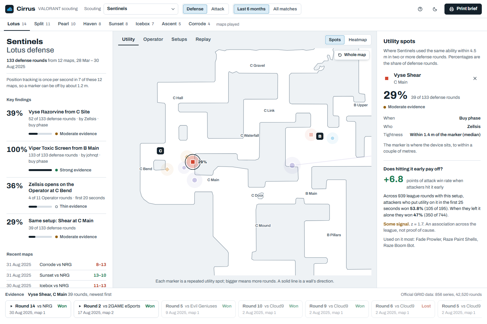

# Cirrus

**Cirrus turns official GRID match data into opponent scouting for Cloud9's VALORANT and Game Changers coaches.**

Pick an opponent, a map and a side. Cirrus answers the two questions coaches usually spend hours of VOD review on:

- **Where does the opponent put their utility?**
- **Who holds the Operator, and where?**

Every claim shows its sample size, how strong the evidence is, and the exact rounds behind it, each replayable in 2D.

> Sky's The Limit 2026 · Cloud9 x JetBrains Hackathon · **Category 1: VALORANT Tactical Scouting, Utility Placement & Operator Profiler**

**Try it:** [zuhairhalawa.github.io/cirrus-scout](https://zuhairhalawa.github.io/cirrus-scout/) (hosted demo, aggregate statistics only)

**Watch the demo (2:30):** [youtu.be/CmnCiIJSmDE](https://youtu.be/CmnCiIJSmDE)



## What a coach gets

- **Findings in plain language.** For example: "Killjoy Turret at B Kitchen: 45 of 84 defense rounds, placed by cortezia, buy phase", marked as strong evidence.
- **Utility map.** Every repeated utility spot on a floor plan, sized by how many rounds use it, with a spots view and a density heatmap. Filter by utility type, round phase (setup, mid-round, post-plant) and period.
- **Operator profiler:**
  - buy rate and primary holder
  - where the Operator opens (the first 20 seconds), with each round counted once
  - share of sightings by round time (0–20 s, 20–40 s, 40 s+), labelled aggressive, on-site or passive
  - kill sightlines from shooter to victim, opening picks highlighted
- **Other tracked weapons.** A short list of the Outlaw, Marshal and Odin bought on the map: rounds bought, who carries it and where it opens, in the Operator tab and the print brief.
- **Setups.** The team's recurring trap and cam setups ("Turret at Mid Boiler: 26 of 51 rounds"), and how predictable they are against every other team on that map.
- **Counters tested league-wide.** Select a defensive spot and Cirrus checks every round in the data where any defense used it. It compares attack win rates when attackers hit the spot with utility early and when they didn't, with counts and a significance test.
- **Game plan.** The counters for a team's defense in one list: which of their setups are worth hitting early, which are better left alone, and which show no reliable edge. Each row opens the spot on the map with its numbers.
- **Evidence and 2D replay.** Every finding lists its rounds: opponent, date, round number, result. One click replays the round: players with trails, every ability where it was cast, kills, plant and defuse.
- **Self-scouting.** Point it at Cloud9 or Cloud9 GC to see what opponents can read from Cloud9's own habits.
- **Print brief.** A one-page version for the pre-match meeting.

## It says what it doesn't know

- **No landing points.** The data records where a player stood and aimed, not where utility landed. Markers show exactly that. Smokes aimed on a tactical map (Brimstone, Omen, Astra, Clove) are listed, not drawn.
- **Tracking rate.** 233 of the 2,077 maps have positions only once per second. Views that include them say so, and say how far a marker can be off.
- **Thin evidence is labelled thin.** Strength comes from a Wilson interval on the share and the sample size.
- **Counters are observational.** The app says "an association across the league, not proof of cause" next to every result.

## How it works

```
GRID feeds (.jsonl.zst) ─┐
ability supplement ──────┼─► scout/extract.py ─► derived/series/*  (one streaming pass per series, parallel)
meta/*.csv ──────────────┘                    │
                                              ▼
                          scout/build.py ─► derived/store.pkl  (columnar store + vector floor plans)
                                              │
                          scout/analysis.py ◄─┘  spots · Operator profile · setups · counters · evidence
                                              │
                 scout/server.py (JSON API) ──┴─► web/ (React + TypeScript, SVG map, 2D replay)
```

- **Scale:** 856 series, 2,077 maps, 42,520 rounds, 1.44 M ability casts and 297 k kills. Processing takes a few minutes on a laptop; a view then answers in under a second.
- **Integrity gates.** A map is analysed only if its rebuilt rounds add up to the official score (one is left out). A round is analysed only if its result agrees with its sides (three are left out).
- **Setups as they actually stood.** A device picked up and placed again in the buy phase counts once, where it ended up.
- **No Riot art.** Each map's floor plan is traced into vectors from where players actually stood, so it lines up with the data by construction. Callout names come from the community valorant-api.com metadata, which uses the same coordinates.
- **Numbers come from code, not a language model.** The sentences are templates filled in from computed counts.

See [docs/METHODOLOGY.md](docs/METHODOLOGY.md) for how every number is produced, how it was checked, and where the limits are.

## Run it locally

You need Python 3.12+ and Node 20+.

```bash
# 1. Get the official data next to this project (never inside it)
git clone https://github.com/cloud9esports/stl-hackathon-2026-grid-starter.git ../stl-hackathon-2026-grid-starter

# 2. Install
pip install -r requirements.txt
cd web && npm install && npm run build && cd ..

# 3. Process the data (a few minutes), then serve
python -m scout all
python -m scout serve        # open http://127.0.0.1:8765
```

Set `STL_DATA_DIR` if the data lives somewhere else.

During UI development, run `cd web && npm run dev`; it proxies `/api` to the Python server.

## Scouting brief

Generate a Markdown scouting brief for a team, map, and side — ready to paste into a prep document:

```bash
python -m scout brief --team MIBR --map icebox --side defense --period all
```

Example output (invented names and numbers):

```markdown
# Echo — Icebox (defense)

**Sample:** 50 rounds across 8 maps (Last 6 months, 15 May – 20 Nov 2026)

## Key findings

- **Killjoy Turret at B Kitchen** — 30 of 50 defense rounds, strong evidence

## Game plan

- Hit the Killjoy Turret at B Kitchen early (set in 30 of 50 rounds): attackers won 58% (70 of 120) when they did, 46% (230 of 500) when they left it. Clear signal. Common tools: Sova Recon Bolt, KAY/O FRAG/ment.
- Killjoy Alarmbot at A Main (set in 14 of 50 rounds): no reliable edge either way (410 league rounds).

_This is an association across the league, not proof of cause._

## Utility

- **Killjoy Turret** at B Kitchen — 30 of 50 rounds, placed by Vexa, buy phase

## Operator

- **Buy rate:** 40% (20 of 50 rounds)
- **Primary holder:** Orin (90% of Operator rounds, 18 rounds)
- **Opening picks:** 4 of 10 Operator kills

## Setup

- **Recurring setup:** Killjoy Turret at B Kitchen + KAY/O FRAG/ment at A Main — 18 of 50 rounds
- **Predictability:** 65% of trap and cam placements land on a reused spot
```

Use `--out brief.md` to write to a file.

## Tests

```bash
python -m pytest
```

97 tests. The unit tests run anywhere. The data tests need the processed data and check Cirrus against the source:

- every analysed map reproduces its official score
- every reported spot share is recounted cast by cast, for five team views
- one headline number is rebuilt from the raw GRID files by separate code and must match exactly
- a finding, its map marker and its list row always show the same percentage

## The hosted demo

The [hosted demo](https://zuhairhalawa.github.io/cirrus-scout/) is built by GitHub Actions ([demo.yml](.github/workflows/demo.yml)). Each run fetches the official data repository, processes it, runs the tests against it, and deploys only the aggregate export. No data is stored in this repository.

`python -m scout export` writes that aggregate-only version into `web/public/data`: spot clusters, smoothed density grids, percentages, at most 25 sightlines per view, and a small set of showcase replays. The organizers confirmed this is allowed under section 4(b) of the data license ([forum thread](https://cloud9.devpost.com/forum_topics/45930-hosting-a-public-demo-with-aggregate-stats-derived-from-grid-data-allowed)).

The demo covers Cloud9, Cloud9 GC, every team they played and the most-played Game Changers teams. The full app, with every team, round-phase filters and replays of every round, runs locally against your own clone of the data.

## The data stays out of this repository

The GRID data is licensed only for this hackathon and must not be redistributed. This repository contains code only.

- **.gitignore:** excludes the data clone, every `.zst`/`.jsonl`, the `derived/` cache and the exported demo data.
- **Pre-commit guard:** `scripts/check_no_data.py` refuses to commit any of it. Install it with `python scripts/check_no_data.py --install`.

## Demo video

Watch it on YouTube: [youtu.be/CmnCiIJSmDE](https://youtu.be/CmnCiIJSmDE)

`video/make_video.py` produces the demo video from the running app:

- needs the extras in `requirements-video.txt`
- reads every number it speaks from the live API, so the narration always matches the screen
- synthesizes narration with a neural voice
- drives the real UI with Playwright at 1080p
- mixes the audio and burns in subtitles with ffmpeg

## JetBrains tools

[Junie](https://junie.jetbrains.com/), JetBrains' coding agent, worked on this repository: tasks 1 to 6 through the Junie CLI (version 26.11.2), and task 7 inside [JetBrains Air](https://www.jetbrains.com/air/), with each of its commands approved one by one. Every task it was given is kept in [docs/junie-tasks](docs/junie-tasks), in the order it ran:

| Task | What Junie did |
|---|---|
| [01-guidelines](docs/junie-tasks/01-guidelines.md) | Read the codebase and wrote its own project guidelines, [.junie/AGENTS.md](.junie/AGENTS.md): the pipeline, the commands, the data-license rules and the analysis conventions a change must respect. Junie loads this file on every later task. |
| [02-scouting-brief](docs/junie-tasks/02-scouting-brief.md) | Built the scouting brief: [scout/brief.py](scout/brief.py), the `python -m scout brief` command, [tests/test_brief.py](tests/test_brief.py) and the README section above. |
| [03-brief-review](docs/junie-tasks/03-brief-review.md) | Fixed seven findings from a review of its first version. The main one: it had used a 30-day window where the app uses six months, so the brief reported 23 rounds where the app reported 84. |
| [04-brief-second-review](docs/junie-tasks/04-brief-second-review.md) | Fixed three remaining findings and added the tests that should have caught them. |
| [05-game-plan](docs/junie-tasks/05-game-plan.md) | Built the game plan: the classification and ordering in `scout/analysis.py`, the `plan` key of the payload, the brief section, 22 tests and the methodology section. |
| [06-game-plan-in-the-app](docs/junie-tasks/06-game-plan-in-the-app.md) | Fixed six review findings on task 5, then added the game plan to the web app: types, the section in the findings column, selection through the existing handler, styles and the help entry. |
| [07-other-weapons](docs/junie-tasks/07-other-weapons.md) | Run in JetBrains Air. Added the other tracked weapons (Outlaw, Marshal, Odin): a summary built from the existing Operator profile, the `weapons` key of the payload, lines in the brief, a list in the Operator tab, 12 tests and the methodology paragraph. It measured the cost first: about 12 ms per view. |

How the work was split:

- Junie wrote the code and the tests. Each task ended with Junie running the whole test suite.
- Each result was then checked outside Junie by running the brief on real views and comparing it with the app's payload. That check, not the passing tests, is what found the problems in tasks 3 and 4. The review files record them as they were written at the time.
- After the brief's second review, a last pass by hand changed wording only: one sentence form, one error hint, and the invented names in the examples.
- The game plan's rows in the app were restyled by hand after task 6 to reuse the finding-row pattern; Junie's version worked but looked like a different app. The export also got a three-line change by hand so the hosted demo has the counter for every plan row.

Junie joined after the pipeline, the analysis and the web app were in place. Its work is the guidelines, the scouting brief, the game plan and the other-weapons summary; the seven task files are the complete record of it.

A longer account, including what went wrong and how it was caught, is in [docs/junie-case-study.md](docs/junie-case-study.md).

## Project layout

| Path | What it is |
|---|---|
| `scout/extract.py` | Streaming GRID + supplement parser, one series at a time |
| `scout/build.py` | Columnar store, integrity gates, final-setup rule, vector floor plans |
| `scout/abilities.py` | Ability catalogue: category and what a cast position means |
| `scout/analysis.py` | Spots, Operator profile, setups, counters, findings |
| `scout/replay.py` | 2D replay of one round |
| `scout/server.py` | Local JSON API + static file server (standard library only) |
| `scout/export.py` | Aggregate-only static demo export |
| `scout/brief.py` | Markdown scouting brief generator |
| `web/` | React + TypeScript front end |
| `tests/` | Unit tests and data-integrity tests |
| `video/` | Scripted demo video pipeline |
| `docs/METHODOLOGY.md` | Methods, checks, limits |

## Data and trademarks

Match data is provided by GRID. VALORANT is a trademark of Riot Games, Inc. This project is not endorsed by Riot Games, GRID or Cloud9.

Code: MIT, see [LICENSE](LICENSE). The GRID data is proprietary and not covered by that license, see [NOTICE](NOTICE).
